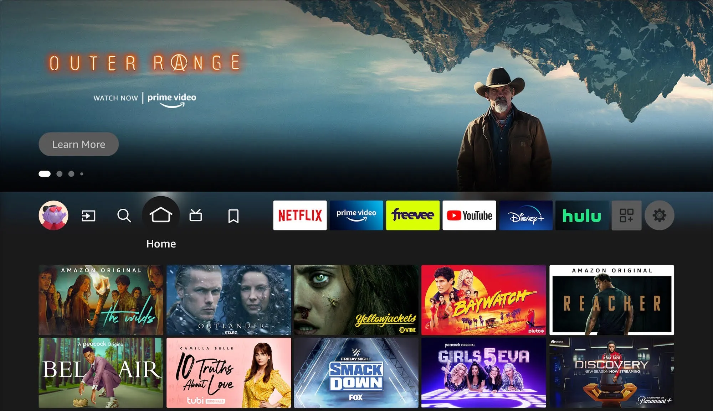
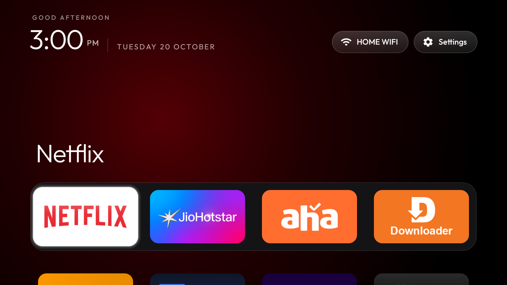
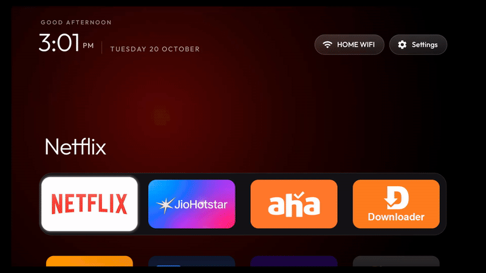

# firetv-clean-root

Native launcher replacement, system debloat, and Appstore DRM bypass for Amazon Fire TV devices using in-memory root.

[The prompt](PROMPT.md) · [Architecture](docs/ARCHITECTURE.md) · [Debloat list](profiles/sheldon_lite_fireos7.txt) · [Hotstar Kiwi patch](docs/HOTSTAR_KIWI_PATCH.md) · [Troubleshooting](docs/TROUBLESHOOTING.md)

Unlike Google TV or standard Android TV, Fire OS marks its stock launcher (`com.amazon.tv.launcher`) and telemetry services as protected system packages. Standard `pm disable-user` calls fail with `SecurityException`, and button-remapping apps rely on accessibility key listeners that introduce a 500–1500 ms delay and get killed by Amazon OTA updates.

This repository pairs [GhostLock](https://github.com/R0rt1z2/GhostLock) (an in-memory kernel root exploit by R0rt1z2 based on CVE-2024-43499) with direct Android package manager calls to disable the stock launcher completely and bind [CleanYourTV](https://github.com/Gathin23/cleanyourtv) directly to `android.intent.category.HOME`. Hardware Home presses resolve instantly with 0 ms latency.

---

## Visual Comparison

| Before (Stock Fire OS 7) | After (CleanYourTV Native Handover) |
| :--- | :--- |
| Ad-sponsored banners, autoplay trailers, heavy telemetry services, 3.5–4.5 system load average. | Minimalist clean grid, zero ads, telemetry neutralized, privacy-anonymized network indicator. |
|  |  |

### Live Handover & Settings Demo
Native 0 ms return to CleanYourTV on Home button press, followed by direct navigation to native Fire TV Device Settings:



---

## Launcher Modifications for Fire OS

The included CleanYourTV build (`launcher/cleanyourtv-release.apk`) contains modifications tailored specifically for Fire OS behavior:

1. **Fire OS Settings Intent Routing (`CTSDummySettingsHandler` Bypass):**
   - **Problem:** Upstream CleanYourTV triggers standard `android.settings.SETTINGS`. On Fire OS, Amazon intercepts this action and routes it to `com.amazon.tv.settings.v2.compliance.CTSDummySettingsHandler` (a compliance stub that executes `finish()` immediately upon launch, causing the Settings button to fail silently).
   - **Fix:** In [`Config.systemIntent()`](launcher/app/src/main/java/com/gathin/tvhome/Config.java#L295-L330), the launcher checks resolved activity class names, detects `CTSDummy*` stubs, and redirects directly to `com.amazon.tv.settings.v2/.tv.device.DeviceActivity` (and Wi-Fi to `com.amazon.tv.settings.v2/.tv.network.NetworkActivity`).
2. **SSID Privacy Anonymization:**
   - The top status pill replaces raw Wi-Fi network SSIDs with `"HOME WIFI"` to prevent leaking private home network names during screen recordings, screenshots, and repository demos.

---

## Compatibility & Amazon Patching Status

### Does this work on the latest Fire TV Stick or has Amazon patched it?

| Platform / Generation | Fire OS Version | Root Vector (GhostLock) | Custom Launcher Handover | Status |
| :--- | :--- | :--- | :--- | :--- |
| **Fire TV Stick Lite / 3rd Gen** (`sheldon` / `sheldonp`) | Fire OS 7.7.1.6 (Android 9) | Vulnerable (CVE-2024-43499) | `cmd package set-home-activity` | **Fully Functional** |
| **Fire TV Stick 4K 1st Gen** (`mantis`) | Fire OS 6.2.x / 7.x | Vulnerable | `cmd package set-home-activity` | **Fully Functional** |
| **Fire TV Stick 4K Max 1st Gen** (`kara`) | Fire OS 7.2.x - 7.6.x | Vulnerable | `cmd package set-home-activity` | **Fully Functional** |
| **Fire TV Stick 4K / Max 2nd Gen** (2023+) | Fire OS 8 (Android 11) | **Patched** (Linux Kernel 5.4/5.10) | Protected package enforcement | **Patched (Requires New Exploit)** |
| **Future Amazon Hardware** | Vega OS (Linux / React Native) | Not Applicable (No Android runtime) | No Android APK or ADB shell | **Incompatible by Architecture** |

### Detailed Patching Breakdown:
1. **Kernel Exploit Patching:** GhostLock leverages CVE-2024-43499 in Linux kernels 4.4 and 4.9 (MediaTek MT8695/MT8696 platforms). Fire OS 8 devices run kernel 5.4 or 5.10 with newer memory allocators and ASLR, neutralizing the in-memory race condition.
2. **Local ADB Port Blocking:** Recent Fire OS 7.6.x+ and Fire OS 8 updates disable loopback ADB connections on `localhost:5555`. This killed userland tools like Launcher Manager and Wolf Launcher that depended on local on-device ADB loops. Remote ADB over Wi-Fi from an external host (the method used in this repo) remains operational when Developer Options are enabled.
3. **Package Manager Disabling Restrictions:** On Fire OS 8 and recent patched Fire OS 7 builds, Amazon added `com.amazon.tv.launcher` to a protected system package whitelist in `PackageManagerService`. Running `pm disable-user` without root throws `java.lang.SecurityException: Cannot disable a protected package`.
4. **Framework API Persistence:** On any Fire OS device where root (`uid=0`) is established (via GhostLock or hardware bootloader exploits), Android's native `cmd package set-home-activity` remains functional because it is part of the core Android ActivityManager architecture.
5. **Vega OS Migration:** Amazon is actively phasing out Android/Fire OS on future smart displays and streaming devices in favor of "Vega OS" (a proprietary Linux OS with React Native applications), which eliminates APK installation and ADB debugging altogether.

---

## Tested Hardware & Software

- **Primary Test Device:** Amazon Fire TV Stick Lite (2020, `sheldon` / `AFTSS`)
- **Firmware:** Fire OS 7.7.1.6 (Android 9 Pie, Linux Kernel 4.9.117)
- **SoC:** MediaTek MT8695D (ARM Cortex-A53, 1 GB RAM)
- **Target Compatibility:**
  - Fire TV Stick Lite / 3rd Gen (2020, `sheldon` / `sheldonp`), Fire OS 7
  - Fire TV Stick 4K 1st Gen (2018, `mantis`), Fire OS 6 / 7
  - Fire TV Stick 4K Max 1st Gen (2021, `kara`), Fire OS 7
  - Any Fire OS device compatible with [GhostLock](https://github.com/R0rt1z2/GhostLock)

---

## Quick Start (One Command)

### 1. Enable ADB on Fire TV
1. On your Fire TV, open `Settings` > `My Fire TV` > `About`.
2. Highlight your device name and click the select button 7 times to enable Developer Options.
3. Go back one screen > `Developer Options` > turn on **ADB Debugging**.

### 2. Run Setup
```bash
./clean.sh <FIRE_TV_IP>
```
*Example: `./clean.sh 192.168.1.50`*

Options:
- `./clean.sh <IP> --launcher-only`: only install CleanYourTV and set default Home.
- `./clean.sh <IP> --debloat-only`: only debloat telemetry, ads, and set AdGuard DNS.
- `./clean.sh <IP> --build`: rebuild launcher APK from source using Gradle.

The script executes the complete setup in one pass:
1. Connects to the Fire TV over ADB with connection timeout safeguards.
2. Initializes the GhostLock root daemon (`/data/local/tmp/gl/ghostlock_root`).
3. Disables 35+ Amazon telemetry, ad, and recommendation services.
4. Configures system-wide AdGuard Private DNS (`dns.adguard-dns.com`).
5. Installs the CleanYourTV native launcher and pre-compiles dex via `dex2oat`.
6. Disables `com.amazon.tv.launcher` and registers CleanYourTV as default HOME.
7. Disables Amazon OTA update services.
8. Neutralizes Hotstar Kiwi DRM account enforcement if Hotstar is detected.

Alternatively, paste [PROMPT.md](PROMPT.md) into Claude Code, Antigravity, or your AI coding assistant to run the process step by step.

---

## Warning & Note on Third-Party Streaming Apps (Hotstar)

Modifying bytecode in proprietary streaming applications carries the inherent risk of account flagging, session invalidation, or service suspension if backend security attestation detects altered APK signatures. The maintainers of this repository are **NOT responsible for any loss of account access, bans, or damages**.

- **Zero-Risk Alternative Path:** If you want a completely risk-free option without modifying any code, **simply log into your Amazon account on the Fire TV Stick**. The Kiwi check only triggers when no Amazon account is present on the device.
- **Maintainer Usage Note:** The author is actively using this patched Hotstar build on their personal Fire TV Stick at their own risk; to date, no account bans, flags, or integrity blocks have been encountered, and 4K Widevine L1 playback works without issue. See [docs/HOTSTAR_KIWI_PATCH.md](docs/HOTSTAR_KIWI_PATCH.md) for full smali reverse engineering details.

---

## Reverting to Original State

To undo all modifications and bring the Fire TV back to its original state (note: this does NOT perform a factory reset; all user data, sideloaded apps, and login credentials remain completely intact):
```bash
./restore.sh <FIRE_TV_IP>
```

---

## Repository Structure

```
firetv-clean-root/
├── clean.sh                 # Single one-line setup script with timeout guards
├── restore.sh               # One-line rollback to original Amazon state
├── PROMPT.md                # Pasteable prompt for AI coding assistants
├── launcher/
│   └── cleanyourtv-release.apk  # Prebuilt CleanYourTV launcher binary (328 KB)
├── profiles/
│   ├── sheldon_lite_fireos7.txt # Debloat profile for Fire TV Stick Lite (Fire OS 7)
│   └── mantis_4k_fireos6.txt    # Debloat profile for Fire TV Stick 4K (Fire OS 6)
├── docs/
│   ├── ARCHITECTURE.md          # Exploit details, SELinux patching, and Home intent routing
│   ├── DEBLOAT_LISTS.md         # Full package breakdown: safe vs load-bearing
│   ├── HOTSTAR_KIWI_PATCH.md    # Smali reverse engineering, Kiwi DRM, and account warnings
│   └── TROUBLESHOOTING.md       # Recovery steps, ADB fixes, and rollback
├── CONTRIBUTING.md
├── LICENSE
└── README.md
```

---

## Safety Whitelist

The scripts will never touch:
- Bluetooth remote pairing and input services.
- On-screen keyboard (`com.amazon.tv.ime`).
- System settings menu (`com.amazon.tv.settings.v2`).
- User-installed IPTV credentials (`com.onnet.systems.iptv.pioneer`).

---

## Credits & Upstream

- [GhostLock](https://github.com/R0rt1z2/GhostLock) by [R0rt1z2](https://github.com/R0rt1z2) — temporary kernel root exploit targeting MediaTek Fire OS devices.
- [CleanYourTV](https://github.com/Gathin23/cleanyourtv) by [Gathin23](https://github.com/Gathin23) — minimal native TV launcher and Google TV debloat prompt.

---

## License

MIT License. See [LICENSE](LICENSE).
